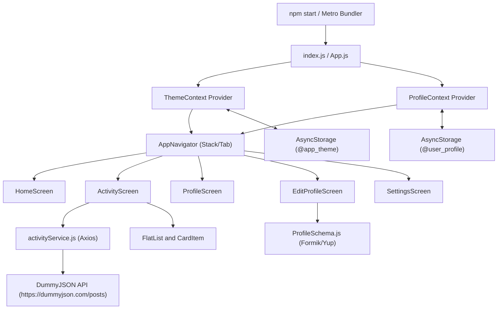

# Integration & Dependency Map

This document outlines the system integration, module dependencies, data flow, and component interfaces for MMA301 Assignment 1 based strictly on the Master Plan.

---

## 1. System Execution & Component Integration Architecture

---

## 2. Component Dependency Chain

The Master Plan specifies explicit integration chains across components, services, state providers, and external data sources:

1. **Application Shell & Navigation Integration**
   `App.js` → `ThemeProvider` + `ProfileProvider` → `AppNavigator.js` → `Navigation Containers (Bottom Tabs / Native Stack)` → `[HomeScreen, ActivityScreen, ProfileScreen, EditProfileScreen, SettingsScreen]`

2. **Profile Read & Persistence Flow**
   `ProfileScreen.jsx` → `useContext(ProfileContext)` → `ProfileContext.js` → `AsyncStorage.getItem('@user_profile')` → `JSON.parse()` → `Safe Fallback (TrangTTT)` → `Render Profile UI`

3. **Profile Edit, Validation & Save Flow**
   `EditProfileScreen.jsx` → `Formik (initialValues)` → `Yup Validation Schema (ProfileSchema.js)` → `On Submit` → `ProfileContext.saveProfile(updatedData)` → `AsyncStorage.setItem('@user_profile', JSON.stringify(data))` → `Context State Update` → `Navigation.goBack()` → `ProfileScreen Automatic Re-render`

4. **Activity List, API & Component Integration**
   `ActivityScreen.jsx` → `useEffect()` → `activityService.getActivities()` → `Axios Client` → `GET https://dummyjson.com/posts` → `State Set` → `FlatList (keyExtractor, ListEmptyComponent)` → `CardItem.jsx (reusable component rendering title, body, tags, likes, views)`

5. **Theme Preference Integration**
   `SettingsScreen.jsx` → `useContext(ThemeContext)` → `ThemeContext.toggleTheme()` → `AsyncStorage.setItem('@app_theme')` → `ThemeContext State Update` → `App-wide Dynamic Stylesheet Re-theme`

---

## 3. Requirement Traceability & Integration Table

| Requirement ID | Feature Area | Source / UI Component | State & Service Layer | Storage / External API | Verification Test |
| :--- | :--- | :--- | :--- | :--- | :--- |
| **R01** | App Structure / Navigation | `src/navigation/AppNavigator.js` | React Navigation Stack/Tab | N/A | TC01, TC12 |
| **R02** | Profile Read | `src/screens/ProfileScreen.jsx` | `ProfileContext.js` | `AsyncStorage (@user_profile)` | TC02 |
| **R03** | Profile Edit (Controlled Form) | `src/screens/EditProfileScreen.jsx` | `ProfileContext.js` (Formik) | `AsyncStorage (@user_profile)` | TC03, TC04, TC05 |
| **R04** | Form Validation | `src/screens/EditProfileScreen.jsx` | `src/storage/ProfileSchema.js` | N/A | TC03, TC14 |
| **R05** | App-wide Theme / Preference | `src/screens/SettingsScreen.jsx` | `src/contexts/ThemeContext.js` | `AsyncStorage (@app_theme)` | TC06 |
| **R06** | List & API Integration | `src/screens/ActivityScreen.jsx` | `src/services/activityService.js` | `https://dummyjson.com/posts` | TC08, TC09, TC10 |
| **R07** | AsyncStorage Persistence | `App.js` | `ProfileContext`, `ThemeContext` | `AsyncStorage` | TC07, TC11 |
| **R08** | Reusable Components | `src/components/CardItem.jsx`, `CardShortCut.jsx` | Props interface | N/A | TC12 |
| **R09** | Responsive Flexbox Layout | `src/styles/*.jsx` | StyleSheet | N/A | TC01, TC16 |
| **R10** | Error / Fallback State | `ProfileContext`, `ThemeContext` | `try-catch` error boundaries | Default State Fallbacks | TC03, TC09, TC11 |

---

## 4. State Ownership & Data Integration Matrix

| State Type | State Scope | Owner Component / File | Persistence Target | Consumers / Dependent Screens |
| :--- | :--- | :--- | :--- | :--- |
| **Profile Shared State** | Global Context | `ProfileContext.js` | `AsyncStorage (@user_profile)` | `ProfileScreen`, `EditProfileScreen`, `HomeScreen` |
| **Theme Shared State** | Global Context | `ThemeContext.js` | `AsyncStorage (@app_theme)` | All App Screens & Navigators |
| **Form Edit State** | Local Component | `EditProfileScreen.jsx` | Temporary until submitted | `EditProfileScreen` inputs |
| **Activity List State** | Local Screen State | `ActivityScreen.jsx` | Memory (fetched via Axios API) | `ActivityScreen` FlatList, `CardItem` |
| **Search & Filter State** | Local Screen State | `ActivityScreen.jsx` | Memory | Filtered list items |

---

## 5. Component Impact & Change Integration (Transfer Practice)

| Extension / Modification | Affected Component(s) | State Layer Impact | Storage Layer Impact | Affected Verification Tests |
| :--- | :--- | :--- | :--- | :--- |
| **Basic: Add Phone & Location** | `ProfileScreen.jsx`, `EditProfileScreen.jsx` | `ProfileContext.js` (`profile` state model) | `ProfileSchema.js` validation & `AsyncStorage (@user_profile)` | Profile read, edit, validation, persistence |
| **Basic: Reset Edit Form** | `EditProfileScreen.jsx` | Formik local form state | None | Edit invalid / valid / cancel tests |
| **Medium: Favorites Persistence** | `ActivityScreen.jsx`, `CardItem.jsx` | `FavoritesContext` or local activity state | `AsyncStorage (@user_favorites)` | Activity interaction & persistence tests |
| **Medium: System Theme Preference** | `ThemeContext.js`, `SettingsScreen.jsx` | `ThemeContext.js` (`theme` preference) | `AsyncStorage (@app_theme)` + system appearance listener | Theme toggle & persistence tests |
